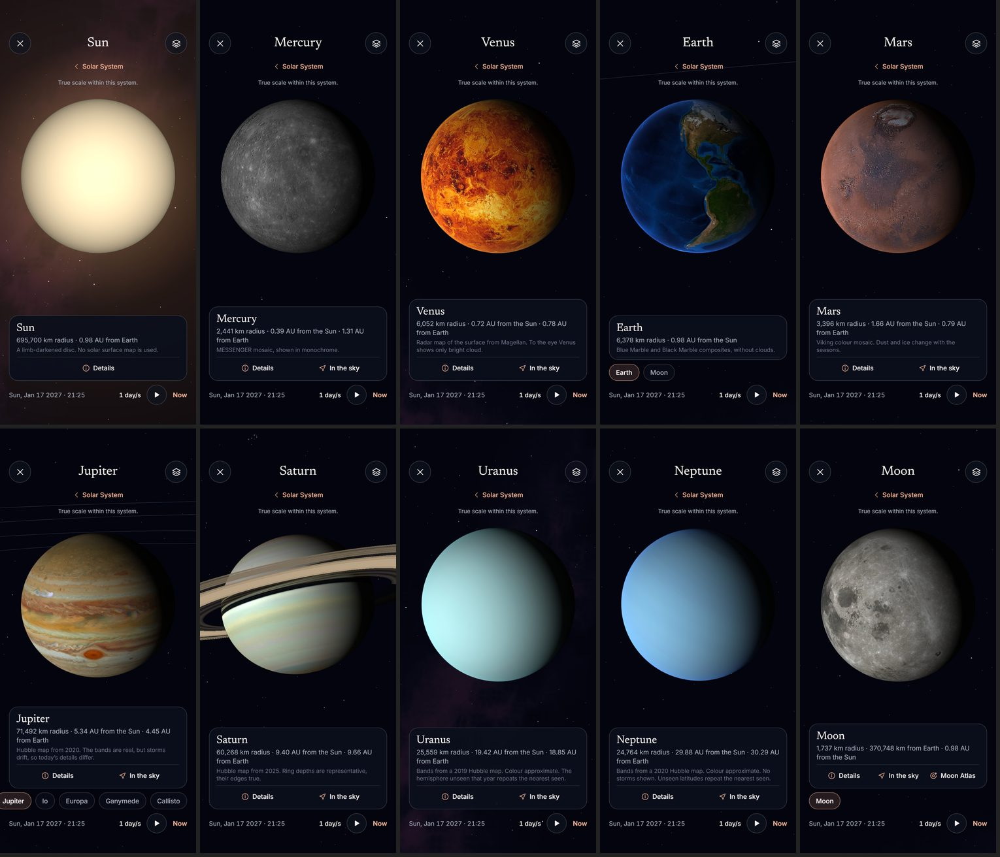
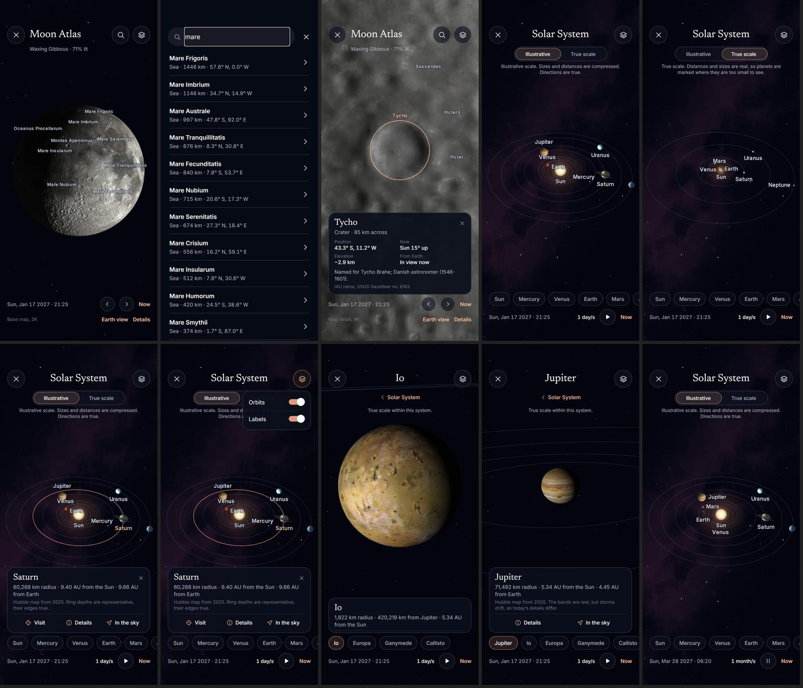
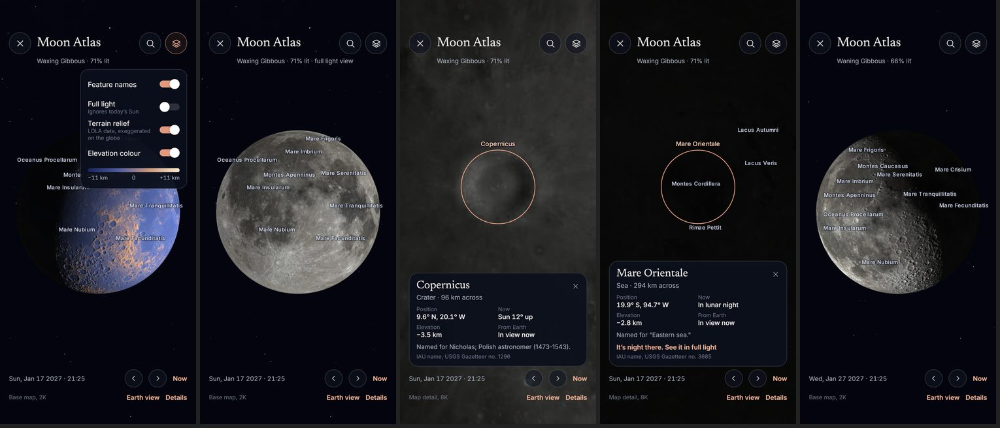

# SkyLens V1 — Správa za Stage 3

Dátum: 2026-11-02. Vetva `skylens-rn`, nič nie je pushnuté a TestFlight sa nezmenil. Stav je overený testami a vo webovom builde. Na iOS ani na iPhone Stage 3 nebežal, takže o natívnom správaní a snímkovej frekvencii nič netvrdím.

## 1. Čo je hotové

### 3D Slnečná sústava (`/solar-system`)

| Požiadavka | Výsledok |
|---|---|
| Slnko a osem planét, reálne polohy | Astronomy Engine, porovnané s JPL Horizons (časť 3) |
| Orbitálny pohyb a Time Travel | Spoločné hodiny aplikácie, rýchlosti 1 deň až 1 rok za sekundu, Play, Pause, Now |
| Kamera | Otáčanie, posun dvoma prstami, štipnutie, zotrvačnosť, klepnutie, dvojklepnutie, plynulý prelet |
| Pohľad na planétu | NASA a USGS mapy, príchod na osvetlenú stranu, sklon a rotácia z modelu IAU, terminátor, nočné svetlá Zeme, prstence Saturna s tieňmi |
| Mesiace | Mesiac, Io, Europa, Ganymede, Callisto. Iba tie majú overený model. Dráhy sa kreslia z toho istého modelu |
| Dráhy a popisy | Prepínače v paneli, dráhy aj pre mesiace, popisy sa neprekrývajú |
| Mierka | Illustrative a True scale, s vetou priamo na obrazovke, čo je skreslené. Pohľad na planétu je vždy v skutočnej mierke |
| Prepojenia | Details otvorí existujúci Object Detail, In the sky existujúce Find in Sky, Mesiac vedie do Atlasu |
| Načítanie | Malé mapy sú hneď, veľké až pri priblížení. V pamäti sú najviac štyri veľké. Chýbajúca mapa nechá hladký glóbus, nikdy nie cudzí obraz |

### Moon Atlas (`/moon-atlas`)

| Požiadavka | Výsledok |
|---|---|
| Interaktívny glóbus | Skutočný ray-tracovaný glóbus, nie statický obrázok. Ťah, štipnutie, dvojklepnutie |
| Postupné načítanie | Základná mapa 2K, potom dlaždice 4K a 8K podľa priblíženia, kontrola CRC, najviac 12 dlaždíc v pamäti |
| Oficiálne názvy | 9 087 útvarov z USGS Gazetteeru, hľadanie s preklepmi priamo v Atlase aj v univerzálnom vyhľadávaní |
| Správna poloha | Popisy a značky sa počítajú zo šírky a dĺžky, test to overuje na reálnom katalógu |
| Karta útvaru | Typ, veľkosť, poloha, nadmorská výška, poloha Slnka, viditeľnosť zo Zeme, pôvod mena, číslo v Gazetteeri |
| Osvetlenie a fáza | Skutočné Slnko pre daný čas, terminátor, fáza, posun po dňoch, spoločné hodiny aplikácie |
| Libration | Earth view pozerá zo sub-Earth bodu a natočí sever podľa pozičného uhla |
| Terén | Reliéf aj farebná výška z údajov LOLA, s legendou |
| Offline | Všetko je v aplikácii, 4,5 MB. Vyššie rozlíšenie ako 8K je mimo balíka, časť 6 |

### Zapojenie do existujúcich obrazoviek

Explore (záložka Solar System), Object Detail (Explore in 3D, Moon Atlas), panel na oblohe (Browse) a univerzálne vyhľadávanie (kategória Moon). Žiadna existujúca obrazovka nebola prerobená. Vybraná planéta sa zapisuje do spoločného výberu, čas a poloha pozorovateľa zostávajú spoločné.

## 2. Voľba renderera

| Možnosť | Verdikt |
|---|---|
| **Skia runtime shadery (zvolené)** | Už je v aplikácii a na TestFlighte kreslí oblohu. Každé teleso je elipsoid alebo prstenec, preto ich lúč vypočíta presne, bez sietí. Žiadna nová natívna závislosť |
| `expo-gl` + `three` | Nová natívna vrstva a veľký JS balík. Bez iPhonu ju nemám ako overiť |
| `react-native-filament` | Vyžaduje `worklets-core`, ďalší natívny kód a riziko pri React Native 0.88 |
| `react-native-wgpu` | Mladý projekt a nová natívna vrstva |

Dôsledok: žiadna migrácia a žiadna zmena natívneho buildu, teda aj nižšie riziko pre TestFlight. Cena je, že asteroidy alebo nepravidelné mesiace by tento prístup nevedel nakresliť. V1 ich nepotrebuje.

## 3. Veda a tolerancie

Porovnané s JPL Horizons, `tests/fixtures/horizons-solar-v1.json`:

Každá veličina je porovnaná na piatich dátumoch od roku 1900 do 2100.

| Veličina | Najhoršia odchýlka | Limit testu |
|---|---|---|
| Heliocentrické polohy planét | 15,4″ | 20″ |
| Geocentrický Mesiac | 11,6 km | 15 km |
| Galileovské mesiace | pod 460 km | 500 km |
| Nultý poludník planét | 0,01° | 0,05° |
| Sub-Earth bod Mesiaca | 0,006° | 0,01° |
| Sub-solárny bod Mesiaca | 0,0014° | 0,01° |
| Osvetlenie Mesiaca | 0,01 percentuálneho bodu | 0,05 |
| Pozičný uhol pólu Mesiaca | 0,003° | 0,02° |

Ďalej testy overujú: sub-solárny bod Zeme pri slnovrate a poludní, orientáciu máp (Mare Imbrium, Humorum, Tranquillitatis sedia na správnom mieste), matematiku kamery a spätnú projekciu klepnutia, skutočné veľkosti a vzdialenosti v pohľade na planétu.

Chyba zachytená verifikáciou: JPL stredné elementy pre ostatné mesiace (Titan, Triton a ďalšie) sa odchyľovali až o 200 % dráhy. JPL sám píše, že nie sú určené na výpočet polôh. Kód som preto odstránil a tieto mesiace v aplikácii nie sú.

## 4. Licencie

Každý súbor má v `assets/solar/provenance.json` zdroj, dátum, SHA-256, licenciu a úpravy. Test kontroluje kontrolné súčty oproti skutočným súborom.

| Dáta | Zdroj | Práva |
|---|---|---|
| Mesiac: mapa, dlaždice, výšky | NASA SVS CGI Moon Kit 4720 (LRO LROC WAC, LOLA) | NASA, uvedené autorstvo. Postavené z archívnych dát PDS. Na stránke nie je výslovná licencia |
| Názvy útvarov | USGS Gazetteer, IAU WGPSN | Public domain |
| Merkúr, Venuša, Mars, Io, Ganymede, Callisto | USGS Astrogeology | Public domain |
| Europa | USGS, Becker et al. 2010 | Bez obmedzení, s citáciou autorov |
| Zem | NASA Earth Observatory | NASA, s uvedením zdroja |
| Jupiter, Saturn, Urán, Neptún | Hubble OPAL, doi:10.17909/T9G593 | CC BY 4.0, povinné uvedenie je v aplikácii |

Kurátorské obrázky z webu LROC použité nie sú, ani zdroje v stave HOLD. Rozhodnutie o Moon Atlas zdroji z decision logu je tým vyriešené v smere, ktorý si schválil.

Čo mapy naozaj zobrazujú, je napísané priamo na karte planéty:

- Venuša je radarová mapa povrchu v syntetickej farbe.
- Jupiter a Saturn sú snímky z konkrétneho roka. Búrky sa medzitým posunuli. 11,2 % a 7,2 % mapy bez dát je doplnených z najbližšej šírky.
- Urán a Neptún: z Hubbla je len jas podľa šírky, 32 % a 21 % šírok nebolo pozorovaných a opakuje susednú. Farba je približná.
- Slnko nemá povrchovú mapu. Hĺbka prstencov Saturna je reprezentatívna, ich okraje sú skutočné.
- SVS uvádza, že mapa Mesiaca je optimalizovaná na vzhľad, nie na vedu. Polohy útvarov preto pochádzajú z Gazetteeru.

## 5. Výkon

Merané v Node na tomto PC. Je to spodná hranica, nie výsledok zo zariadenia.

| Operácia | Čas |
|---|---|
| Príprava scény Slnečnej sústavy | 0,36 ms |
| Príprava scény planéty s mesiacmi | 0,16 ms |
| Výber popisov z 9 087 útvarov | 1,80 ms |
| Rozpoznanie klepnutia na Mesiaci | 6,09 ms |
| Stav Mesiaca pre daný čas | 0,78 ms |

| Záťaž | Hodnota |
|---|---|
| Nárast aplikácie | 6,6 MB (Slnečná sústava 2,1 MB, Mesiac 4,5 MB) |
| Pamäť textúr, odhad | Do približne 100 MB na vrchole: 4 mapy 2K, základ Mesiaca, reliéf a 12 dlaždíc |
| Kreslenie | Iba keď sa niečo hýbe, inak raz za sekundu, Atlas raz za minútu |

Web beží v softvérovom GL, preto z neho snímkovú frekvenciu neuvádzam. Rozpočet 20 ms na snímku je stále `DEVICE_NOT_TESTED`.

## 6. Čo chýba

| Položka | Stav |
|---|---|
| Natívne overenie iOS | Čaká na spoločný test na iPhone. Maestro flow `maestro/09_solar_and_moon.yaml` je pripravený, ešte nebežal |
| Ďalšie mesiace (Titan, Triton a iné) | Nie sú. Bez overeného modelu by ich polohy boli vymyslené. Horizons fixtúry sú pripravené na prípadné fitovanie modelu |
| Mapa Mesiaca nad 8K | Pri veľkom priblížení je mapa mäkká. SVS ponúka približne 27K, ale to si vyžaduje hosting a sťahovanie, čo je tvoje rozhodnutie |
| Terén pri veľkom priblížení | Dáta LOLA v aplikácii majú 4 body na stupeň, teda menej detailov než mapa. Reliéf je pri priblížení preto jemný |
| Dlaždice pri póloch | Štyri sloty pokrývajú pri póloch menšiu časť obrazu. Zvyšok ostáva na základnej mape |
| Smer dĺžky máp Galileovských mesiacov | Nie je nezávisle overený |
| Pinch na iOS | Na webe funguje cez dotykové udalosti, na iPhone nie je overený |

## 7. Riziká na iOS

- **Shadery Mesiaca a planét:** kompilujú sa v Skia na webe. Metal môže mať iné limity, najmä pri šiestich textúrach Mesiaca.
- **Výkon na celej obrazovke:** shader Mesiaca robí pri reliéfe päť vyhľadávaní výšky na pixel. Na ProMotion to môže byť citlivé.
- **Dekódovanie JPEG:** beží v JS vlákne, pri prvom otvorení mapy 2K môže byť krátky záhyb.
- **Veľkosť súboru:** `File.size` v `expo-file-system` je na natívnom čítaní katalógu nová závislosť. Ak zlyhá, Atlas povie, že katalóg sa nedal prečítať, a mapa beží ďalej.
- **Gestá:** idú cez JS vlákno, rovnako ako obloha.

## 8. Testy a dôkazy

| Kontrola | Výsledok |
|---|---|
| Unit a vedecké testy | 263 prešlo, 2 preskočené, 0 zlyhalo. Z toho 100 je nových pre Stage 3 |
| Webové flowy | 56 z 56 v poslednom úplnom behu, z toho 17 nových pre Stage 3 |
| TypeScript | Bez chýb |
| Natívny iOS | Nebežal |

Pri overovaní som našiel a opravil tieto chyby:

- Klepnutie na Jupiter vyberalo Mars, lebo vyhrávalo teleso bližšie ku kamere v okolí prsta.
- Tri shadery nešli skompilovať pre rezervované názvy a odovzdávanie shaderu do funkcie.
- Prstence pri malej veľkosti blikali do jednotlivých bodov.
- Urán vyzeral krémovo a mal tmavú nepozorovanú pologuľu.
- Mesiac v lunárnej noci bol čierny kruh. Pribudla slabá hladina svetla a odkaz na plné osvetlenie.
- Reliéf pri veľkom priblížení vyrábal čierne škvrny z hrubej mriežky výšok.

Jedna nevysvetlená udalosť: v predposlednom úplnom behu raz klepnutie na Jupiter vybralo Venušu. Ďalej som to nezopakoval, v piatich nasledujúcich behoch tohto scenára prešlo. Upravil som poradie výberu, aby disk pod prstom mal prednosť pred cudzím popisom, a scenár teraz pri zlyhaní vypíše presné súradnice. Príčinu však nemám dokázanú, preto si to treba všimnúť pri teste na iPhone.

Vizuálne dôkazy sú v `docs/skylens-v1/evidence/stage3/`, 25 stavov. Spoločné prehľady:

## 9. Ďalší krok

Stage 3 je lokálne hotový a čaká na tvoj súhlas s pushom. Bez pushu nebeží ani iOS build v cloude. Ďalšia etapa sa začne po tvojom pokyne.
