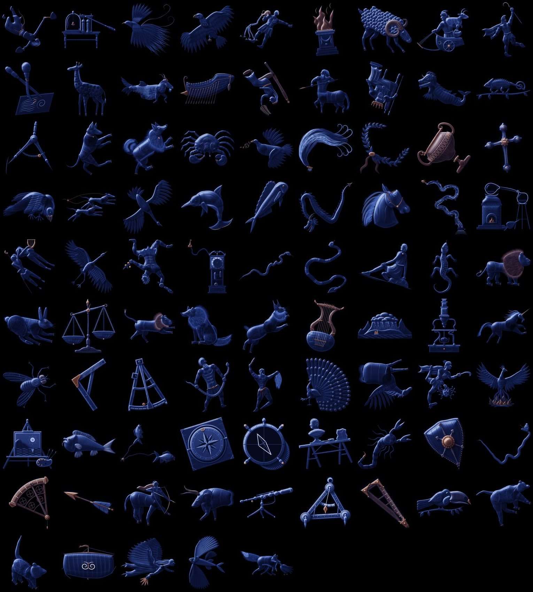
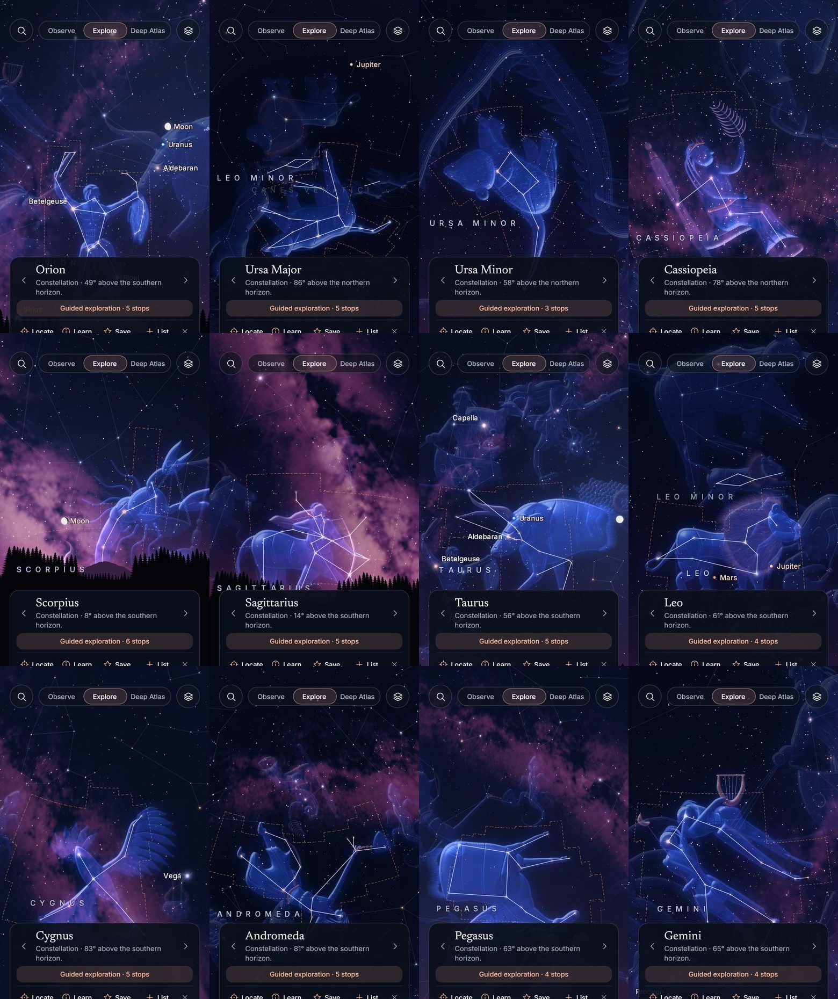
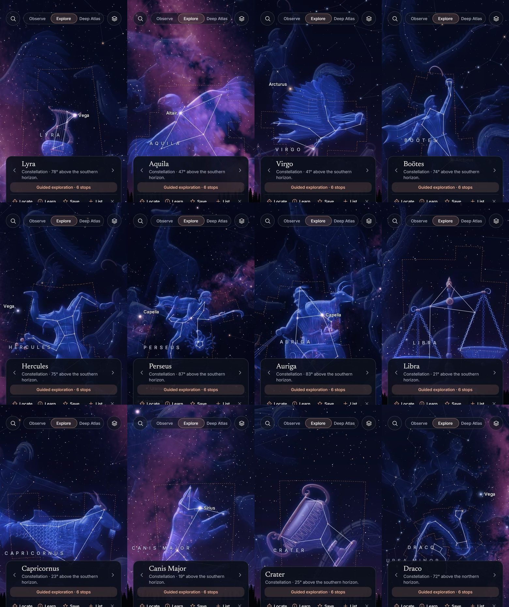
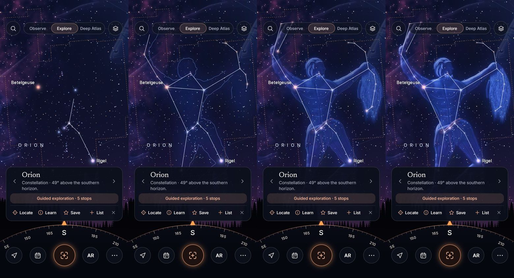

# SkyLens V1 — Správa za Stage 4: Súhvezdia

Dátum: 2026-11-02. Vetva `skylens-rn`, nič nie je pushnuté a TestFlight sa nezmenil. Stav je overený testami a vo webovom builde. Na iOS ani na iPhone Stage 4 nebežal, takže o natívnom správaní a snímkovej frekvencii nič netvrdím.

## 1. Čo je hotové

| Požiadavka | Výsledok |
|---|---|
| Pôvodná artwork | **86 z 88 figúr.** 64 finálnych, 22 prijateľných s pomenovanou slabinou, 2 nenakreslené (Corona Borealis, Puppis). Tie majú iba skutočné čiary a hviezdy, bez náhrady |
| Oddelené dáta | Čiary a poloha v katalógu, kotvy a obrysy v `constellationArt.json`, vektorové zdroje v `scripts/constellation-art/figures/`, výtlačky v `assets/constellation-art/` |
| Priorita | 12 prioritných figúr malo vlastné kolá revízií pred rozšírením na ostatné |
| Animácie | Postupné kreslenie čiar od najjasnejšej hviezdy, záblesk hviezd, obrys, nábeh figúry, zvýraznenie vybranej hviezdy, plynulé názvy, jemná paralaxa iba hmly za figúrou, existujúci let kamery |
| Príbehy | Všetkých 88. Veda, história a tradície v oddelených častiach, s menom kultúry a zdrojom |
| Integrácia | Klepnutie na figúru, vyhľadávanie aj bežnými menami (Big Dipper, Teapot, Plough), Find in Sky, Object Detail, panel na oblohe začína súhvezdím v zábere |
| Sprievodca | Všetkých 88. 12 má napísané trasy, ostatné sú zostavené z katalógu. Zastávka je iba ID objektu, takže každú polohu dáva engine |
| Vrstvy | Nezávislé prepínače pre čiary, názvy, artwork a animáciu, plus posuvník krytia. Reduce Motion má vždy prednosť |
| Výkon | Orezanie mimo záberu, najviac 6 figúr na snímku, cache sietí a textúr, skrývanie podľa priblíženia, jedna animácia odhalenia naraz |

V Observe a Deep Atlas je artwork predvolene vypnutá a po zapnutí slabšia.

## 2. Ako artwork vzniká, a čo to znamená pre práva

Toto je najdôležitejšia časť správy.

**Figúry napísal Claude,** teda ja a štyria paralelní agenti, ako vektorové súradnice nad skutočnými hviezdami. Tlačí ich náš vlastný renderer `engrave.mjs`. Človek ich nekreslil. Nepoužil sa žiadny generátor obrázkov, žiadna fotobanka ani cudzia ilustrácia a žiadna figúra nie je obkreslená.

Prečo nie generátor obrázkov: AI art je v decision logu otvorené rozhodnutie o právach a tvoj pokyn zakazuje importovať artwork s nevyriešenými právami. Generovaný obrázok sa navyše nedá presne ukotviť na hviezdy.

**Čo ostáva otvorené.** Odpadá závislosť od podmienok poskytovateľa, nie však otázka autorstva. Figúry sú dielom AI a nie je isté, či sa na ne vzťahuje autorské právo. Prakticky to znamená, že ich môžeš používať, ale možno by si nedokázal zabrániť niekomu inému, aby ich skopíroval. Pre veľkú komerčnú značku sa to oplatí ukázať právnikovi. Text v aplikácii (Credits) to uvádza pravdivo.

**Figúra nie je to isté čo procedurálna náhrada.** Každá je zložená jednotlivo pre svoje hviezdy, napríklad Regulus na hrudi leva a Deneb na chvoste labute. Automaticky sa rozsypávajú iba jednotlivé chlpy srsti.

## 3. Zmena, ktorú musíš vidieť

**Schválený obraz Oriona na oblohe som nahradil novým.** Starý je vygenerovaný cez AI s otvorenými právami a k ostatným 85 figúram by nepasoval. Nový je úmyselne v tom istom jazyku: tmavomodrá rytina so svetlým okrajom.

Úprimné porovnanie: **starý obraz má bohatšiu anatómiu.** Nový má zato hviezdy skutočne na tele, napríklad celý opasok na opasku a kyj na hviezdach kyja, kým starý musel kryť časť čiar. Súbor `orion-art.jpg` ostáva v repozitári, ale do aplikácie sa nebalí. Návrat je malá zmena kódu, ale vráti otvorenú otázku práv. Toto rozhodnutie je tvoje, pozri `V1_DECISION_LOG.md`, body 38 až 50.

Názov ORION sa posunul asi o 20 bodov, lebo stred figúry je teraz na tele nového Oriona.

## 4. Vedecká presnosť

| Meranie | Výsledok | Limit testu |
|---|---|---|
| Figúra voči kotevným hviezdam, 86 figúr, 4 pozorovatelia, 5 kamier, 4 viewporty, otočenia | **najviac 0,70 bodu** v 47 778 viditeľných polohách | 1 bod |
| Time Travel v rozsahu ±199 rokov | **najviac 2,66′**, hviezdy sa pritom posunú až o 12,4′ | 12′ |
| Živá aplikácia: posun, štipnutie, naležato, rok 1801 a 2199, počas odhalenia | **najviac 0,34 bodu** | 1,6 bodu |
| Bajt po bajte: polohy hviezd po všetkom, čo volajú animácie | Bez zmeny | Zhoda |

Figúra sa ťahá so sebou aj pri vlastnom pohybe hviezd, takže hviezdy z nej neuchádzajú ani po stáročiach. Animácie polohy iba čítajú.

**Odchýlka 2,66′ je najhorší prípad:** rýchla hviezda (Arcturus) pri okraji rozsahu dátumov. Pri bežnom priblížení je to zlomok veľkosti hviezdy na obrazovke, pri najväčšom priblížení, pri ktorom sa ešte figúra kreslí, asi jeden až dva body.

Mimo záberu chyba rastie, lebo stereografická projekcia tam veľmi naťahuje. Test preto meria iba to, čo je vidieť (do 40 bodov za okrajom).

**Príbehy.** Text som napísal z vlastných znalostí a potom ho nezávisle skontroloval ďalší agent oproti zdrojom (Ridpath, Theoi, primárne texty). Z **približne 47 overených tvrdení** našiel 19 chýb a 10 pochybností. Všetky sú opravené.

Príklady: Homér v Odysei nemá škorpióna, Crotus nie je u Eratostena syn Pana, Mintaka nie je veľobor. Vedecká oprava: hviezdy Oriona nie sú úplne nesúvisiace, opasok a meč patria do asociácie Orion OB1.

**Čo z toho vyplýva:** ak z 47 skontrolovaných bolo 19 zlých, nepreverený zvyšok pravdepodobne tiež obsahuje chyby, najmä v klasických citáciách. Pred vydaním odporúčam redakčnú kontrolu odborníkom. Toto je najväčšie otvorené riziko obsahu.

Test overuje, že vedecká časť neobsahuje mýtus. Moderné súhvezdia nemajú vymyslený príbeh, obrazovka to povie priamo.

## 5. Licencie

Žiadne nové dáta ani obrázky neboli importované. Čiary a hranice ostávajú z d3-celestial, zdroje v stave HOLD sa nepoužili a modely Night Sky sa nepoužili. `V1_SOURCE_MATRIX.md`, `ASSET_CREDITS.md` a `LICENSES.md` sú aktualizované. Otvorený ostáva pôvod čiar d3-celestial, ako doteraz.

## 6. Výkon

Merané v Node na tomto PC. Je to spodná hranica, nie výsledok zo zariadenia.

| Meranie | Hodnota |
|---|---|
| Výpočet siete pre 6 najväčších figúr naraz, 2 733 vrcholov | 0,04 ms na snímku |
| Nárast aplikácie | 7,1 MB výtlačkov a 0,3 MB dát. Starý Orion, 0,16 MB, ubudol |
| Pamäť textúr, odhad | Do približne 90 MB, ak je naraz načítaných 9 najväčších figúr, zvyčajne menej |

Web beží v softvérovom GL, preto z neho snímkovú frekvenciu neuvádzam. Cena vykreslenia na GPU nie je zmeraná. Rozpočet 20 ms ostáva `DEVICE_NOT_TESTED`.

## 7. Čo chýba

| Položka | Stav |
|---|---|
| Natívne overenie iOS | Čaká na spoločný test na iPhone. Maestro flow `maestro/10_constellations.yaml` je pripravený, ešte nebežal |
| Corona Borealis | Bez figúry. Tri pokusy boli strnulé, tak ostala nenakreslená |
| Puppis | Bez figúry. Vyzerala ako klobúk, nie ako korma lode, preto som ju odstránil. Carina a Vela existujú, loď Argo je teda neúplná |
| 22 prijateľných figúr | Každá slabina je pomenovaná v `V1_CONSTELLATION_MATRIX.md`. Patria sem aj moje prioritné Leo, Andromeda, Cassiopeia a Pegasus |
| Vizuálna kontrola na oblohe | Na bežiacej oblohe som videl 24 figúr. Ostatných 62 iba ako výtlačok na čiernom, ich ukotvenie je však zmerané. Južná obloha sa z Bratislavy v dema nedá ukázať |
| Príbehy | Väčšina tvrdení nie je overená zdrojom, časť 4 |
| Zábery odhalenia | Softvérové GL nestíha, preto sú tieto snímky urobené pozastavením hodín animácie. Samotná plynulosť nie je overená |

## 8. Riziká na iOS

- **`drawVertices` s obrazovým shaderom:** na webe funguje, na Metal zatiaľ neoverené. Ak zlyhá, figúry sa môžu nezobraziť.
- **Výkon pri širokom zábere:** až šesť prekrývajúcich sa textúr v režime Plus na celej obrazovke je nová záťaž, najmä na ProMotion.
- **Dekódovanie JPEG:** beží vo vlákne JS. Pri rýchlom otáčaní cez nové súhvezdia môže byť krátky záhyb.
- **Pamäť:** figúry sa vytláčajú z pamäte, keď ich je viac ako 9, ale limit nie je overený na zariadení.
- **Gestá:** klepnutie na figúru má nové poradie výberu, na dotyk prstom to treba overiť.

## 9. Testy a dôkazy

| Kontrola | Výsledok |
|---|---|
| Unit a vedecké testy | 306 prešlo, 2 preskočené. Z toho 43 nových pre Stage 4. Pri záťaži občas zlyhá 1 test času, pozri nižšie |
| Stage 4 webové flowy | 17 zo 17 |
| Webové flowy Stage 0 až 3 | 55 z 56 v poslednom úplnom behu. Jediný zvyšný prešiel pri opakovaní, pozri nižšie |
| TypeScript | Bez chýb |
| Natívny iOS | Nebežal |

Pri overovaní som našiel a opravil tieto chyby:

- Klepnutie na figúru takmer vždy vybralo slabú hviezdu v okolí, takže „klepni na Oriona“ prakticky nefungovalo. Teraz figúra vyhrá nad slabou nepomenovanou hviezdou, ale jasná, pomenovaná alebo hviezda priamo pod prstom vyhrá stále. Deep Atlas sa správa ako predtým.
- **Falošný úspech v teste Time Travel:** sonda zmenila čas bez prekreslenia, takže meranie v roku 2199 merala starú snímku. Opravené, test teraz najprv overí, že sa obloha pohla.
- Pri všetkých 86 figúrach sa chyba zväčšila na 9,7 bodu, lebo veľké figúry (Hydra, Eridanus) narazili na limit siete. Limit som zdvihol.
- Dlhý príbeh prechádzal cez živú oblohu v hlavičke a popisy hviezd presvitali cez text.
- Panel navrhoval súhvezdie aj cez deň, keď nie je vidieť.
- Test výkonu meral prvých šesť figúr podľa abecedy. Teraz meria šesť najväčších.

Dve občasné zlyhania, obe časové, limity som neuvoľnil:

- `search-v1`, limit 5 ms: pri súbežne bežiacich testoch nameral až 5,9 ms, samostatne 1,8 ms. V poslednej sérii behov zlyhal asi v každom treťom. Nový balík testov pridal súbežnú záťaž, takže to môže na CI spôsobiť občasné červené behy.
- Flow zatvárania panelu: raz zachytil panel na konci animácie, s krytím 2,5 % oproti limitu 1 %. Pri opakovaní prešiel.

Agenti mali vo svojom zadaní hranice a sami nahlásili drobné odchýlky: raz `git status` iba na čítanie, pár tlačí navyše a dočasný súbor v `/tmp`, hneď zmazaný. Na výsledok to nemalo vplyv.

Dôkazy sú v `docs/skylens-v1/evidence/stage4/`, vrátane `art-review.json` s verdiktom pre každú figúru. Úplná tabuľka je v [V1_CONSTELLATION_MATRIX.md](V1_CONSTELLATION_MATRIX.md).

Všetky výtlačky:

Prioritné figúry na skutočnej oblohe:

Rozšírené figúry na skutočnej oblohe:

Priebeh odhalenia:

## 10. Ďalší krok

Stage 4 je lokálne hotový a čaká na tvoj súhlas s pushom. Bez pushu nebeží ani iOS build v cloude. Ďalšia etapa sa začne po tvojom pokyne.
